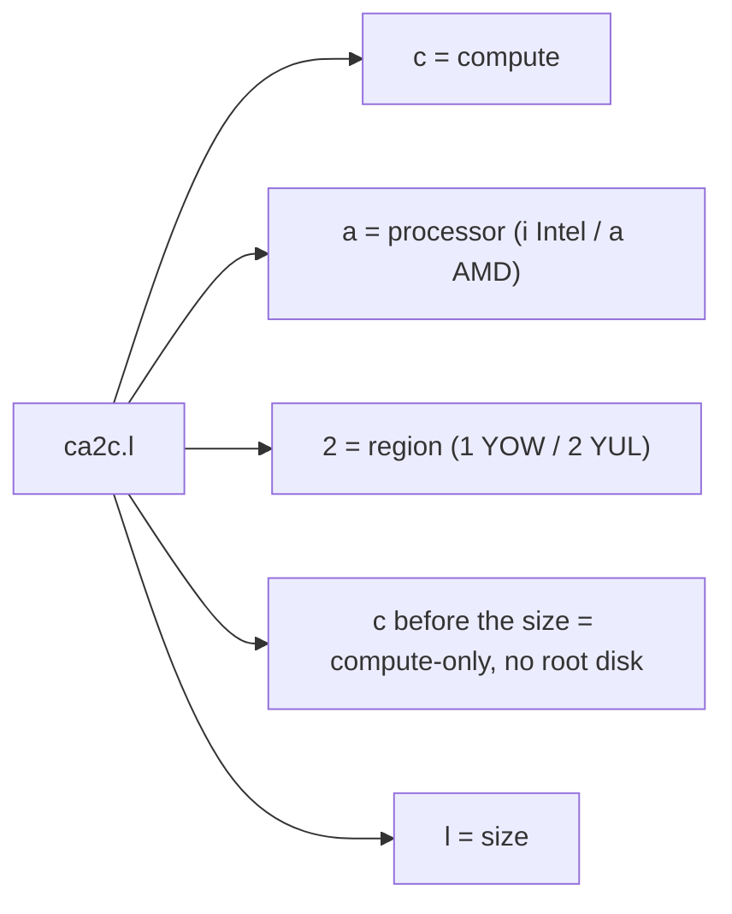
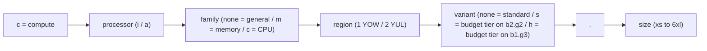

Every compute plan has a short, structured ID such as `ca2c.l` or `cam2c.2xl`. Once you know the
pattern you can read a plan's processor, family, region, storage tier, and size straight from its
name. No lookup table required.

Since October 11, 2026, plans cover CPU and memory only. The root disk is billed separately per GB.
See [Instance Types](/public-cloud/compute/instance-types).

## Anatomy of a plan ID

A plan ID is a **series** followed by a `.` and a **size**:

Memory- and CPU-optimized plans add a family letter, and budget storage tiers add a trailing `s`
(`b2.g2`, YUL) or `h` (`b1.g3`, YOW):

## Segments

| Position     | Values                                  | Meaning                                                                     |
| ------------ | --------------------------------------- | --------------------------------------------------------------------------- |
| Prefix       | `c`                                     | Compute                                                                     |
| Processor    | `i` / `a`                               | Intel / AMD                                                                 |
| Family       | _(none)_ / `m` / `c`                    | General purpose / Memory-optimized / CPU-optimized                          |
| Region       | `1` / `2`                               | YOW / YUL                                                                   |
| Variant      | _(none)_ / `s` / `h`                    | Standard tier / Budget tier on `b2.g2` (YUL) / Budget tier on `b1.g3` (YOW) |
| Compute-only | `c` after the family and variant        | CPU and memory only, root disk billed separately                            |
| Size         | `xs` `s` `m` `l` `xl` `2xl` `4xl` `6xl` | Relative capacity, smallest to largest                                      |

## Plan series

| Series   | Region | Processor | Storage                          | Family                    |
| -------- | ------ | --------- | -------------------------------- | ------------------------- |
| `ci1c`   | YOW    | Intel     | `b1.g1` (shared replicated NVMe) | General purpose           |
| `ci1hc`  | YOW    | Intel     | `b1.g3` (shared HDD)             | General purpose (budget)  |
| `ci2c`   | YUL    | Intel     | `b2.g1` (shared replicated NVMe) | General purpose           |
| `ca1c`   | YOW    | AMD       | `b1.g1` (shared replicated NVMe) | General purpose           |
| `ca1hc`  | YOW    | AMD       | `b1.g3` (shared HDD)             | General purpose (budget)  |
| `ca2c`   | YUL    | AMD       | `b2.g1` (shared replicated NVMe) | General purpose           |
| `ca2sc`  | YUL    | AMD       | `b2.g2` (shared replicated SSD)  | General purpose (budget)  |
| `cim1c`  | YOW    | Intel     | `b1.g1` (shared replicated NVMe) | Memory-optimized          |
| `cim1hc` | YOW    | Intel     | `b1.g3` (shared HDD)             | Memory-optimized (budget) |
| `cim2c`  | YUL    | Intel     | `b2.g1` (shared replicated NVMe) | Memory-optimized          |
| `cam1c`  | YOW    | AMD       | `b1.g1` (shared replicated NVMe) | Memory-optimized          |
| `cam2c`  | YUL    | AMD       | `b2.g1` (shared replicated NVMe) | Memory-optimized          |
| `cam2sc` | YUL    | AMD       | `b2.g2` (shared replicated SSD)  | Memory-optimized (budget) |
| `cac1c`  | YOW    | AMD       | `b1.g1` (shared replicated NVMe) | CPU-optimized             |
| `cac2c`  | YUL    | AMD       | `b2.g1` (shared replicated NVMe) | CPU-optimized             |
| `cac2sc` | YUL    | AMD       | `b2.g2` (shared replicated SSD)  | CPU-optimized (budget)    |

## vCPU-to-RAM ratios

The family determines how vCPU and RAM scale together:

| Family                      | Ratio (RAM:vCPU) | Notes                   |
| --------------------------- | ---------------- | ----------------------- |
| General purpose `xs`–`l`    | 2:1              |                         |
| General purpose `xl` and up | 4:1              | Capped at 16 vCPU       |
| Memory-optimized (`m`)      | 8:1              | For RAM-heavy workloads |
| CPU-optimized (`c`)         | 1:1              | High-density compute    |

:::tip

The full plan catalog, with vCPU, RAM, disk, and pricing for every size, is on the
[pricing page](https://zcp.zsoftly.ca/pricing).

:::
